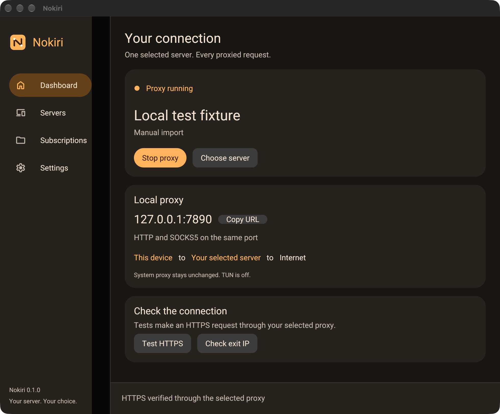

<div align="center">
  
  <h1>Nokiri</h1>
  <p><b>Your server. Your choice.</b></p>
  <p>A small native proxy manager for people who already have a server.<br />Built with Rust and egui. macOS first, Linux in view.</p>
  <p>
    <a href="https://github.com/binido/Nokiri/actions/workflows/ci.yml"></a>
    
    <a href="LICENSE"></a>
    <a href="assets/MIHOMO-LICENSE"></a>
  </p>
  <p><a href="#installation">Install</a> · <a href="#usage">Use Nokiri</a> · <a href="#build-from-source">Build</a> · <a href="#security-and-privacy">Security</a></p>
  
</div>

Nokiri exposes one local HTTP/SOCKS5 endpoint and keeps your chosen server fixed.
It is designed for terminal tools, development clients and applications that
already support proxies. It does not intercept the rest of your Mac's traffic.

## Features

- **Deliberate routing.** Explicit selection, stable server IDs and selection
  persistence across application and core restarts. Duplicate names are safe.
- **Subscriptions without surprises.** Multiple HTTPS subscriptions, manual
  updates, renaming and removal. A failed update preserves the previous catalog.
- **Actual connection checks.** Per-server HTTPS availability and latency,
  selected-proxy HTTPS checks, and a public exit IP obtained through the proxy.
- **Native and quiet.** Rust / egui, bundled Roboto, orange Material 3-inspired
  surfaces, light and dark themes, event-driven repainting and a managed core.
- **Private by default.** Encrypted catalog, macOS Keychain key, localhost-only
  listeners and an authenticated controller. No account or telemetry.

If your selected server fails, proxied connections fail. Nokiri does not choose a
backup or switch to DIRECT. If a subscription removes that server, the proxy
stops and asks you to select a valid server explicitly.

## Installation

This is the initial source release; no public binary release is published by
this implementation. On an Apple Silicon Mac, build `dist/Nokiri.app` using the
instructions below, then open it in Finder. You may copy the bundle into
`~/Applications`. It locates its bundled core independently of the repository.

The local build is ad-hoc signed, **not Developer ID signed or notarized**. See
[distribution notes](docs/distribution.md) for signing, Keychain access after
rebuilding, and the corresponding-source companion needed when sharing the core.

## Usage

1. Open **Subscriptions** and add a name and an HTTPS subscription URL. For a
   single server, choose **Import VLESS / YAML** and paste its URL or YAML.
2. Open **Servers**, select a server explicitly, and optionally run **Test**.
3. On **Dashboard**, click **Start proxy**. The default endpoint is
   `http://127.0.0.1:7890`; the same port accepts SOCKS5.
4. Point your client at that endpoint. Use **Test HTTPS** or **Check exit IP**
   to verify the selected proxy. **Stop proxy** closes the local listener.

For one terminal command:

```sh
HTTPS_PROXY=http://127.0.0.1:7890 HTTP_PROXY=http://127.0.0.1:7890 curl https://example.com
```

Or explicitly use SOCKS5 with remote destination-name resolution:

```sh
curl --proxy socks5h://127.0.0.1:7890 https://example.com
```

Nokiri does not change macOS network settings. Your client's own bypass settings,
such as `NO_PROXY`, remain its responsibility. Settings allow another local port,
a theme, and starting the saved selection when Nokiri opens. Automatic launch at
macOS login is outside this version's scope.

## Supported imports

| Input | Scope |
| --- | --- |
| `vless://` URLs | TCP, WebSocket and gRPC; plain transport, TLS, REALITY; TCP Vision |
| Base64 subscription | Standard / URL-safe Base64, padded or unpadded, containing VLESS URLs |
| Clash / Mihomo YAML | An inline `proxies` list using the supported VLESS fields |

The parser targets common 3x-ui parameters: SNI, client fingerprint, ALPN,
WebSocket path and Host, gRPC service name, REALITY public key and short ID.
It is not a claim of compatibility with every 3x-ui version or export.

Other proxy protocols, XHTTP, HTTP camouflage, WebSocket early data, gRPC multi
mode, multiplexing, arbitrary headers, and disabled certificate verification are
rejected with explanations. Unknown per-proxy fields are rejected. Imports are
all-or-nothing so an unsupported entry cannot silently alter a working selection.
Subscription-provided rules, groups, providers, scripts and listener settings are
never activated. Provider-only YAML without inline proxies is unsupported.

HTTPS subscriptions have a 20-second timeout and 4 MiB / 5000-server limits.
Redirects are refused to avoid disclosing subscription credentials. Availability
tests are manual, do not change selection, and are not background health checks.
See [validation](docs/validation.md) for executed tests and remaining coverage.

## Build from source

Requirements: stable Rust, Python 3, Apple's command-line tools, and macOS on
Apple Silicon. The bundle declares macOS 12 minimum; validation was on the
current development Mac, not every older macOS version.

```sh
git clone https://github.com/binido/Nokiri.git
cd Nokiri
python3 scripts/fetch_core.py
cargo run --locked
```

Build the standalone app:

```sh
python3 scripts/package_macos.py
open dist/Nokiri.app
```

The installer downloads only the pinned official Mihomo release, verifies both
archive and executable SHA-256, and does not execute an unverified binary. The
application verifies the executable again before each activation. For quality
checks and local real-core tests, see [CONTRIBUTING.md](CONTRIBUTING.md).

## Architecture

```text
egui views  ->  command worker  ->  owned catalog + encrypted persistence
                         |
                         +-> validated YAML -> managed Mihomo subprocess
                         +-> authenticated localhost controller
                         +-> explicit HTTP-proxied HTTPS checks
```

Mihomo handles the proxy protocols. Nokiri imports a limited data model and
constructs its own configuration: one selector containing exactly the chosen
server, one `MATCH,NOKIRI` rule, no routing providers and no fallback. Additional
nodes are present only so the controller can test them; they cannot be selected
through the routing group. Stopped-proxy availability tests use a temporary core
with no proxy listener, no selector, and `MATCH,REJECT`.

The engine lifecycle contract is deliberately small. Platform integration is
separate from models, parsing and GUI logic. No sing-box backend is implemented.

## Security and privacy

- The catalog, including URLs, UUIDs, endpoints and settings, is encrypted using
  ChaCha20-Poly1305. The random encryption key is held in macOS Keychain, through
  a `SecretStore` interface. There is no plaintext storage fallback.
- Data lives in the platform application-data directory returned by `directories`,
  outside the repository. On macOS this is `~/Library/Application Support/io.github.binido.Nokiri`.
  The catalog is written atomically with private file permissions.
- Mihomo receives a short-lived private configuration file inside a mode-0700
  temporary directory. It contains the credentials the core must use and is
  removed on normal shutdown. Known secrets are redacted from the in-memory
  diagnostics buffer; no engine log file is written.
- Mixed HTTP/SOCKS5 and controller bind to `127.0.0.1`. The controller uses a
  random per-launch bearer secret. Other local applications can use the mixed
  proxy; the OS user and trusted local software remain the trust boundary.
- Import and update requests go directly to the HTTPS subscription provider.
  Manual connectivity checks contact Google; exit-IP checks contact ipify through
  the selected proxy. No checks run automatically in the background.
- Destination traffic entering the mixed listener has no direct route. OS DNS
  resolution of the upstream hostname and subscription fetching are outside that
  traffic boundary. Nokiri is not a firewall or kill switch for other programs.

A forced application kill or power loss can leave a runtime file and orphaned
core. Nokiri never kills a process it did not retain as its own child. On a
conflict it reports the occupied port rather than terminating another process.
Back up the encrypted catalog **and its credential-store key** together; one
without the other cannot restore your subscriptions.

## Linux roadmap

The models, parser, strict config, controller and egui interface are shared.
Linux builds select Secret Service and XDG data directories. Linux CI is
configured; Linux GUI operation and packaging have not been executed here.

Before an Arch Linux release: pin and verify an official Linux x86_64 core,
exercise a running Secret Service, test X11/Wayland, add desktop/SVG icon assets
and native packaging, then consider an optional user systemd unit. No Linux
core installer, AppImage, Arch package or systemd service is shipped yet.

## License and credits

Nokiri's original application source and routing mark use the [MIT license](LICENSE).
The separately executed, unmodified Mihomo binary uses [GPL-3.0](assets/MIHOMO-LICENSE).
A redistributed app bundle includes both licenses and dependency notices; the
MIT license does not replace the core's source-distribution obligations.
See [third-party notices](THIRD_PARTY_NOTICES.md) and [distribution](docs/distribution.md).

Built with [egui](https://github.com/emilk/egui), [Tokio](https://tokio.rs),
[reqwest](https://github.com/seanmonstar/reqwest), and
[Mihomo](https://github.com/MetaCubeX/mihomo). Typography is Google's
[Roboto](https://github.com/google/fonts/tree/main/ofl/roboto) (OFL-1.1);
UI icons are [Material Symbols](https://github.com/google/material-design-icons)
(Apache-2.0). The repository presentation was inspired by
[Purge](https://github.com/jithin-sabu/purge-app), with original text and assets.

Screenshots show the implemented application using a local VLESS test fixture,
not a supplied production subscription. No private endpoints or credentials are
included. Light mode: [view screenshot](docs/screenshots/dashboard-light.png).
